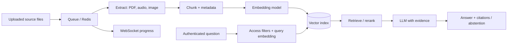
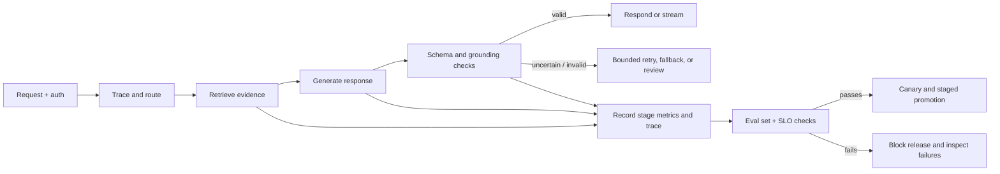
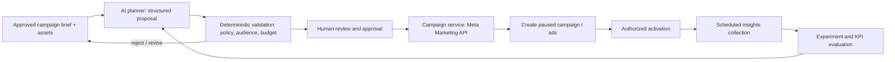
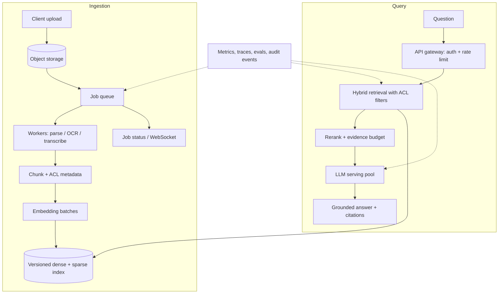

# AI Engineer Interview Preparation Guide

> **Audience:** Mueem Nahid Ibn Mahbub  
> **Target roles:** Applied AI Engineer, AI Engineer, Agentic AI Engineer, LLM / RAG Engineer, and MLOps Engineer  
> **How to use this guide:** Answer each question aloud before reading the model answer. Replace any implementation detail that does not match your actual work. Claims about your projects below are grounded in your supplied résumé and portfolio context; design recommendations are labeled as recommendations.

## 1. Executive Summary & Candidate Profile

### Candidate profile

Mueem is a software engineer with about five years of experience across backend, full-stack, AI application, and infrastructure work. The strongest fit is for **applied AI engineering**: turning models and retrieval into dependable product features, then operating the APIs, asynchronous jobs, cloud resources, and monitoring around them.

The résumé supports three especially useful interview stories:

1. **Production RAG at Brand Cloud Inc.** — context-aware answers over large documents and multimodal inputs (audio and images), with Redis-backed asynchronous work, queues, WebSockets, and vector search.
2. **KnowledgeLinks AI** — a user-content RAG application with Next.js, TypeScript, Python, LangChain, OpenAI, ChromaDB, Redis, and PostgreSQL.
3. **Fraud Detection Inference Service** — a tabular fraud model trained with scikit-learn and served through FastAPI, with MLflow for experiment/model lifecycle, Feast and Redis for online features, AWS infrastructure managed with Pulumi, and Prometheus/Grafana monitoring.

Additional strengths include Python, FastAPI, Node.js/TypeScript, PostgreSQL, Redis, Docker, AWS (EC2, S3, ECR, IAM, VPC), GitHub Actions, and production workflow design. The background in full-stack systems is an advantage: AI features still need authentication, data modeling, queues, rate limits, predictable APIs, and a usable failure state.

### Interview positioning

> **One-sentence positioning:** “I’m a software engineer focused on production AI systems: I’ve built RAG workflows and model-serving infrastructure, and I bring the backend, data, and cloud experience needed to make those systems reliable.”

Emphasize these points:

- **End-to-end ownership:** ingestion and serving paths, not only the model call.
- **Reliability:** queues, bounded concurrency, retries, progress reporting, and explicit failure handling.
- **Evaluation:** establish retrieval and model quality measures before optimizing cost or latency.
- **Security:** enforce tenant access and tool permissions in application code; retrieved text and model output are untrusted input.
- **Engineering judgment:** choose a fixed workflow when it is sufficient; add agent autonomy only when dynamic action selection is valuable.

### Facts to prepare before the interview

The CV does not give exact values for traffic, corpus size, p95 latency, cost, chunk size, embedding model for the production system, or measured quality improvement. Prepare real numbers if available. If not, say what you measured, what you would instrument, and what trade-off you made. Do not invent metrics or claim a component choice that you did not personally implement.

### 90-second introduction

“I’m a software engineer with about five years of experience building backend and full-stack systems, and in recent work I’ve focused on applied AI and MLOps. At Brand Cloud, I worked on a RAG system for large documents and multimodal content. We moved long-running ingestion into asynchronous Redis-backed workflows and used WebSockets to report progress so user requests stayed responsive. I also built KnowledgeLinks AI, a RAG application using LangChain, OpenAI, and ChromaDB. On the ML platform side, I built a fraud detection inference service with scikit-learn, FastAPI, MLflow, Feast, Redis, and AWS, including deployment and monitoring. My strength is connecting AI capabilities to the production engineering around them: APIs, data flow, operations, and failure handling. I’m now looking for an AI engineering role where I can deepen my work on retrieval, agents, evaluation, and reliable model services.”

## 2. Core AI & Machine Learning Foundations

### Questions & detailed answers

#### Q1. What is the difference between AI, machine learning, deep learning, and generative AI?

**Model answer:** Artificial intelligence is the broad field of systems that perform tasks associated with intelligent behavior. Machine learning is a subset in which a system learns patterns from data. Deep learning uses multilayer neural networks to learn representations. Generative AI produces new outputs such as text, images, audio, or code. My fraud service used supervised machine learning to classify transactions; my RAG work combines retrieval with a generative model to answer questions from supplied content.

#### Q2. What is the difference between training and inference?

**Model answer:** Training optimizes model parameters against an objective using training data. Inference uses the trained model to produce predictions for new inputs. Training is often a periodic, throughput-oriented batch workload. Online inference usually has stricter latency, availability, and concurrency requirements. In my fraud project I separated model development and tracking from the FastAPI prediction path, which loads the selected production model and retrieves online features before returning a score.

#### Q3. Compare supervised, unsupervised, and self-supervised learning.

**Model answer:** Supervised learning uses labeled examples, such as transactions marked fraudulent or legitimate. Unsupervised learning looks for structure in unlabeled data, such as clusters or anomalies. Self-supervised learning derives training targets from the data itself; next-token prediction is a common example for language models. The fraud classifier was supervised. Embedding and language-model pretraining commonly use self-supervised objectives.

#### Q4. What are overfitting, underfitting, and data leakage?

**Model answer:** Overfitting is fitting training-specific noise, so training performance is strong but validation performance is weaker. Underfitting means the model is too simple or insufficiently trained to capture the signal. Data leakage occurs when information unavailable at prediction time influences training or evaluation—for example, fitting a scaler or oversampler before splitting, or using a post-outcome feature. I compare training and validation metrics, use time-appropriate splits when data is temporal, and fit preprocessing only on training folds.

#### Q5. Explain accuracy, precision, recall, F1, and PR-AUC. Which matter for fraud?

**Model answer:** Accuracy is the share of all predictions that are correct. Precision is the share of predicted positives that are truly positive; recall is the share of actual positives found. F1 is the harmonic mean of precision and recall. PR-AUC summarizes the precision-recall trade-off across thresholds and is informative with a rare positive class. Fraud decisions depend on business costs: a false negative loses money, while a false positive can block a legitimate customer. I would show the confusion matrix and threshold-dependent costs, not rely on accuracy alone. For my project, stratified splitting and class weighting were used to address imbalance.

#### Q6. Why use Random Forest for the fraud project instead of a neural network?

**Model answer:** Random Forest is a practical baseline for structured tabular data. It captures non-linearities and feature interactions, tolerates varied feature scales, and is relatively straightforward to train and serve. A neural network may be preferable with enough data or when representation learning is useful. I would compare candidates on the same leakage-safe splits using PR-AUC, calibration, operating-point costs, inference latency, and maintenance burden. The model choice is an empirical trade-off, not a universal rule.

#### Q7. How does self-attention work in a Transformer?

**Model answer:** Given input representations (X), the layer projects them into queries, keys, and values: (Q=XW_Q), (K=XW_K), (V=XW_V). Scaled dot-product attention is

\[
\mathrm{Attention}(Q,K,V)=\mathrm{softmax}\left(\frac{QK^T}{\sqrt{d_k}}+M\right)V,
\]

where (M) is a mask. The query-key scores express compatibility; the weighted sum of values mixes information. Multi-head attention performs this in several learned subspaces, then combines the heads. Causal masking prevents a language model from seeing future tokens.


#### Q8. What do FlashAttention and KV caching optimize?

**Model answer:** Standard attention materializes large intermediate score matrices, which can create substantial memory traffic. FlashAttention computes exact attention in tiled blocks and uses an online softmax so it avoids storing the full (N\times N) matrix in high-bandwidth memory; this reduces memory traffic and often improves speed. It changes how attention is computed, not the attention result. KV caching addresses autoregressive decoding: keys and values for previous tokens are reused, avoiding recomputation for the growing prefix. The cache consumes memory proportional to active sequence lengths, layers, and KV heads, so it becomes a serving capacity constraint. PyTorch’s scaled dot-product attention can dispatch to optimized backends when supported by the hardware and input shape ([PyTorch attention overview](https://pytorch.org/blog/out-of-the-box-acceleration/)).

#### Q9. Explain LoRA and QLoRA. What is the trade-off?

**Model answer:** Full fine-tuning updates all model weights. LoRA freezes the base weights and learns low-rank updates to selected matrices. For a weight (W), it approximates an update as \(\Delta W = BA\), where the rank is much smaller than the matrix dimensions. This reduces trainable parameters and optimizer state. QLoRA keeps the base model quantized, commonly to 4-bit, and trains LoRA adapters in higher precision. It reduces memory use but adds quantization and compatibility considerations; quality must be evaluated against the full-precision or baseline model. Hugging Face documents NF4/FP4 settings, double quantization, and compute dtype in its [PEFT quantization guide](https://huggingface.co/docs/peft/developer_guides/quantization).

```python
import torch
from transformers import BitsAndBytesConfig
from peft import LoraConfig

quant = BitsAndBytesConfig(
    load_in_4bit=True,
    bnb_4bit_quant_type="nf4",  # Compare with fp4 for your model/task
    bnb_4bit_use_double_quant=True,
    bnb_4bit_compute_dtype=torch.bfloat16,
)
adapter = LoraConfig(
    r=16, lora_alpha=32, lora_dropout=0.05,
    target_modules=["q_proj", "k_proj", "v_proj", "o_proj"],
    task_type="CAUSAL_LM",
)
```

#### Q10. Compare INT8, FP4/NF4, pruning, and LoRA.

**Model answer:** Quantization lowers the precision used to store or compute weights and can reduce memory bandwidth and model footprint. INT8 generally retains more precision than 4-bit formats but offers less compression. FP4/NF4 quantizes more aggressively; NF4 is designed for normally distributed weights and is common in QLoRA workflows. The actual speedup depends on supported kernels and hardware. Pruning removes or sparsifies parameters; unstructured sparsity may not speed up inference unless kernels exploit it, while structured pruning can reduce dimensions but may affect quality. LoRA is a parameter-efficient adaptation method, not a compression method by itself. I would select based on measured task quality, latency, throughput, memory, and deployment support.

#### Q11. When would you fine-tune a model, and when would you use RAG?

**Model answer:** Use RAG when the model needs current, private, or frequently changing facts that can be retrieved at runtime, and when source attribution or access filtering matters. Fine-tuning is more appropriate for persistent behavior changes such as response format, domain-specific patterns, or task performance that examples can teach. Fine-tuning does not reliably serve as a mutable knowledge store, and RAG does not inherently teach new behavior. They can be combined: fine-tune behavior and retrieve changing evidence. I would compare a prompt-only baseline, retrieval baseline, and fine-tuning candidate using a held-out evaluation set, total cost, freshness, and maintenance effort.

## 3. Generative AI, LLMs & Agentic Systems

### Questions & detailed answers

#### Q12. What is an embedding, and how does a vector database use it?

**Model answer:** An embedding maps text or another input to a vector whose geometry reflects learned relationships. At query time, the system embeds the question and searches for nearby document vectors using cosine similarity, dot product, or Euclidean distance. The metric should agree with the model’s training and normalization. A production record should also carry source, tenant, document version, chunk ID, and access metadata; similarity search alone does not enforce authorization.

#### Q13. What is hybrid search, and when would you rerank?

**Model answer:** Dense retrieval matches semantic similarity and can find paraphrases. Sparse retrieval, such as BM25, matches terms and often performs well on exact names, identifiers, and rare tokens. Hybrid search combines their candidate sets or scores. A cross-encoder reranker then scores query-document pairs more precisely over a smaller candidate set. This can improve relevance but adds latency and cost. I would compare dense, sparse, hybrid, and reranked configurations on a labeled query-to-relevant-document set using Recall@k, MRR or nDCG, then measure end-to-end answer quality.

#### Q14. How do chunk size and overlap affect RAG quality?

**Model answer:** Small chunks give precise matches but may lose surrounding definitions; large chunks preserve context but can dilute relevance and consume the prompt budget. Overlap helps facts spanning boundaries but duplicates tokens and can crowd the context. I start with document-aware splits—headings, paragraphs, tables—and tune chunking using representative questions and retrieval metrics. For multimodal inputs, I preserve links from extracted text or descriptions back to the original page, timestamp, or asset.

#### Q15. How would you explain a RAG pipeline?

**Model answer:** The ingestion path extracts content, normalizes it, splits it into chunks, creates embeddings, and indexes those chunks with source metadata. The query path authenticates the caller, applies tenant and permission filters, retrieves candidates, optionally reranks them, and gives a bounded evidence set to the LLM. The answer should cite evidence or abstain when evidence is insufficient. In my work, Redis-backed asynchronous processing and WebSockets separated long-running ingestion from interactive requests.



#### Q16. What makes a good prompt? Explain chain-of-thought and ReAct safely.

**Model answer:** A good prompt states the task, relevant constraints, output schema, evidence policy, and behavior for missing information. I keep system instructions separate from user and retrieved content, and I validate outputs in code. Chain-of-thought prompting asks a model to reason through a task; in a product, I prefer requesting concise rationale or structured evidence checks rather than exposing hidden private reasoning. ReAct interleaves reasoning with actions and observations, which can help with multi-step tool tasks. Each action still requires typed arguments, authorization, timeouts, and bounded steps. A prompt is not a security boundary.

#### Q17. How do you evaluate an LLM or RAG system? What are Ragas and G-Eval?

**Model answer:** I separate retrieval quality from answer quality. For retrieval, use Recall@k, Precision@k, MRR/nDCG, and access-control correctness. For generated answers, measure correctness, relevance, faithfulness to evidence, completeness, citation support, abstention quality, and user task success. Ragas provides reference-free and reference-based metrics for dimensions such as faithfulness and context precision/recall; G-Eval uses an LLM-as-judge rubric to score outputs. Both are useful evaluators, not ground truth. Validate judge agreement against human labels, use task-specific rubrics, keep a stable test set, inspect failures, and combine offline evaluation with production feedback. See [Ragas metrics](https://docs.ragas.io/en/stable/concepts/metrics/available_metrics/) and the [G-Eval paper](https://arxiv.org/abs/2303.16634).

#### Q18. What is hallucination, and how do you reduce it?

**Model answer:** A hallucination is a claim that is unsupported or false but presented as reliable. I would improve retrieval, provide source identifiers, instruct the model to ground claims in supplied evidence, require citations where appropriate, and allow it to abstain. I would evaluate claim support against the sources and investigate retrieval misses separately from generation errors. RAG reduces some risks but cannot eliminate them: evidence can be missing, stale, unauthorized, or misinterpreted.

#### Q19. What is prompt injection in RAG, and how do you defend against it?

**Model answer:** Prompt injection is malicious or conflicting instruction text embedded in user input or retrieved content that attempts to override the intended task. Treat retrieved passages as untrusted data, delimit them clearly, and tell the model that they are evidence rather than instructions. More importantly, enforce authorization, tool allowlists, argument validation, and data access in deterministic application code. Do not let document text grant permissions or trigger privileged actions. Test with adversarial documents and cross-tenant queries.

#### Q20. What is an agent, and when would you use LangGraph or AutoGen?

**Model answer:** A fixed LLM workflow follows predefined steps. An agent can select tools or transitions based on intermediate results. I use agent autonomy only when dynamic action selection provides measurable value; otherwise a deterministic workflow is easier to secure and test. LangGraph is useful for explicit state, conditional edges, checkpoints, and interruptible workflows. AutoGen supports conversational multi-agent patterns. Framework choice does not replace the need to own the state machine, budget, termination conditions, tool policies, and observability. I would first describe the control flow independent of the framework, then explain how the chosen library implements it.

#### Q21. How do you make tool calling safe and reliable?

**Model answer:** Treat the model’s proposed call as untrusted. Define a narrow schema, validate types and business constraints, authenticate the user, check authorization against the authoritative system, apply rate and resource limits, and use idempotency for side effects. Add timeouts, bounded retries, an explicit max-step count, audit traces, and a verification step after execution. Require human approval when the action’s impact calls for it. A schema catches malformed arguments; it cannot prove factual correctness or permission.

```python
from pydantic import BaseModel, Field

class SearchRequest(BaseModel):
    query: str = Field(min_length=3, max_length=500)
    top_k: int = Field(default=5, ge=1, le=20)

def search_for_user(user, raw_args: dict):
    args = SearchRequest.model_validate(raw_args)
    # Authorization is checked in application logic, not inferred from the LLM.
    return vector_store.search(
        args.query,
        k=args.top_k,
        filter={"tenant_id": user.tenant_id},
    )
```

#### Q22. What is MCP, and does it make a tool safe automatically?

**Model answer:** The Model Context Protocol standardizes how an AI application can discover and invoke capabilities such as tools and resources exposed by a server. An MCP client connects and calls those capabilities; an MCP server adapts them to underlying services. MCP is an interoperability protocol, not an authorization or safety layer. Authentication, least privilege, schema and business validation, timeouts, logging, and execution policy still belong in the client/server application. To debug a failing tool, inspect discovery, schema, transport, auth, server logs, returned content, and the downstream service.

### Additional agent interview questions from the shared thread

These questions extend the existing fundamentals and tool-safety answers with topics emphasized in the linked Agentic AI interview preparation. They belong with LLM and agent concepts rather than the algorithm/backend masterclass.

#### How does LangChain differ from LangGraph?

**Model answer:** LangChain provides building blocks and integrations for LLM applications, including models, prompts, retrievers, and tools. LangGraph focuses on stateful orchestration as a graph of nodes and conditional transitions, with support for loops, checkpoints, and interruptible human review. A simple retrieval-and-answer flow may only need a chain. A workflow that retrieves, calls tools, verifies results, retries within limits, and pauses for approval benefits from an explicit state graph. I would select based on control-flow needs and explain the workflow independently of the framework.

#### What is the difference between traditional RAG and Agentic RAG?

**Model answer:** Traditional RAG usually performs a predefined retrieve-then-generate sequence. Agentic RAG lets the workflow adapt retrieval: it may decompose a question, select a search strategy, issue multiple queries, check evidence sufficiency, and retrieve again when evidence is weak. That can help with complex questions but adds model calls, latency, cost, and more failure paths. I would compare it against a fixed hybrid-retrieval baseline on a representative evaluation set and use adaptive retrieval only when the quality gain justifies its cost.

#### What are multimodal LLMs and vision-language models, and how would you use them for documents?

**Model answer:** Multimodal LLMs process or relate multiple input types, such as text, images, and audio. Vision-language models connect image content with language tasks. For document ingestion, I would use text extraction for born-digital text, OCR for scanned pages, and a vision-language model where layout, charts, or visual relationships matter. Audio may be transcribed while preserving timestamps and speaker metadata when useful. I would retain references to the original page, region, or timestamp and evaluate extraction quality on representative files; model output is not ground truth.

#### What kinds of memory should an agent have?

**Model answer:** I separate working state for the current task, relevant conversation history, persistent long-term facts or preferences, and external knowledge retrieved from a source system. Working state should contain the goal, validated inputs, evidence, tool results, and pending approval. Persistent memory should be stored only when it has a clear purpose, with access controls, retention rules, and a way to correct or delete stale information. RAG documents remain an external knowledge source, not automatically user memory. I would avoid sending an entire conversation history into every model call because it increases cost, consumes context, and introduces irrelevant or outdated text.

#### How do you manage a limited context window?

**Model answer:** Keep instructions and evidence relevant to the current step, store structured task state outside the prompt, remove redundant turns, and summarize completed work only when needed. Preserve source IDs and key constraints in summaries, and retrieve evidence on demand. Reserve output capacity and monitor token use. Because summaries are lossy, keep consequential facts traceable to authoritative documents rather than relying on a summary as the only record.

#### When would you use multiple agents instead of one?

**Model answer:** A single agent is simpler to trace and operate. Multiple agents can help when work divides into genuinely independent specialties, parallel research, or independent verification. They also increase model calls, coordination, latency, cost, and disagreement handling. I would first build a single agent with deterministic workflow nodes and measure task failures. I would add separate agents only when evaluation shows a repeatable benefit that outweighs those costs; the coordinator still needs explicit state, permissions, and termination rules.

#### What are Self-RAG and Corrective RAG?

**Model answer:** Self-RAG describes methods where a model uses learned or explicit reflection signals to decide whether retrieval is needed and whether retrieved evidence supports an answer. Corrective RAG (CRAG) evaluates retrieval quality and takes corrective steps when evidence is weak, such as trying an alternate retrieval method or source. Implementations vary, so I would name the exact method being discussed. Both should be evaluated against a simpler RAG baseline for answer quality, added latency, cost, and abstention behavior.

#### How would you evaluate and trace an agent workflow?

**Model answer:** Measure the final task outcome and intermediate decisions: retrieval relevance and access correctness, tool selection, argument validity, tool execution, evidence grounding, citations, completion, and safe abstention. Track latency and cost by node, model call, and tool, along with retries and human escalations. Keep a fixed dataset of realistic tasks and inspect traces to locate whether a failure came from retrieval, model output, validation, or execution. A tracing tool such as LangSmith can capture the sequence of model, retrieval, and tool steps, but tracing alone does not prove correctness. Protect sensitive inputs in stored traces and evaluate changes with task-specific checks.

#### How would you improve an agent that is slow, expensive, or unreliable?

**Model answer:** Trace the complete run and measure time, cost, and failures by step before changing the architecture. Remove redundant model calls, improve retrieval to reduce repeated searches, parallelize independent I/O, cache only safely reusable results, or route simple tasks to a smaller model. For reliability, use typed outputs, bounded retries, timeouts, idempotent side effects, checkpoints, explicit fallbacks, and a maximum step count. Run changes against a stable evaluation set and compare task success, quality, latency, and cost together; optimizing one metric while harming correctness is not an improvement.

### Applied AI performance and marketing automation questions

#### Suppose an LLM system is slow and returns inconsistent results. How would you improve its performance and automate quality control?

**Model answer:** “I would treat inconsistency and slowness as separate symptoms until traces show they share a cause. First I would instrument the complete request path: authentication and queue wait, retrieval, external tools, prompt assembly, model time to first token (TTFT), generation time, and post-processing. I would record p50/p95/p99 latency, input and output tokens, model/prompt/index versions, retries, timeouts, error rates, and cost per successful task. An average latency hides the slow cohort, so I would break metrics down by task type, model route, tenant, and dependency.

“Then I would build a representative, versioned evaluation set and replay each case across repeated runs. I would score factual correctness, grounding against retrieved evidence, instruction adherence, schema validity, and task completion separately. For inconsistent cases I would inspect whether variation comes from sampling, changing retrieval candidates, stale or differently-versioned indexes, nondeterministic tools, mutable conversation state, or upstream failures. Lowering temperature can reduce sampling variance, but it cannot repair weak evidence or incorrect orchestration. Clear instructions, examples, constrained structured output, and Pydantic validation help with format consistency; invalid responses should be repaired or rejected explicitly rather than silently accepted. For factual tasks, improve chunking, embeddings, metadata filters, candidate selection, or reranking and provide a grounded abstention path.

“For latency, optimize the measured bottleneck: reduce irrelevant prompt tokens and retrieved chunks, remove redundant model calls, parallelize independent I/O, reuse clients/connections, and route simple tasks to a smaller model only if it passes the quality bar. Cache only deterministic or safely reusable results, with authorization and freshness in the cache key. Streaming can improve perceived responsiveness by lowering time to first visible output, but it does not necessarily reduce total generation time. Long jobs should run asynchronously; synchronous calls need deadlines, bounded retries, concurrency limits, and a clear fallback or escalation path.

“I would automate the lifecycle as a tested pipeline: request validation and routing, retrieval/generation, response validation, trace and metric recording, then alerting on SLO and quality regressions. Prompt, model, and retrieval changes run against the same eval set in CI; production canaries are promoted only when quality, latency, cost, and error-rate thresholds pass. Failed or low-confidence results can trigger a bounded retry, a validated fallback model, or human review. I would not let an LLM rewrite its own prompt or deploy itself based only on an LLM-judge score. I would inspect material failures and calibrate judge results against human-reviewed examples.”

**How I would apply this to a RAG product:** Keep document ingestion separate from the online query path. Measure ingestion freshness and queue age independently from retrieval and generation latency. Add representative query/evidence/answer cases to the evaluation set, capture stage-level traces, and use the results to decide whether the bottleneck is parsing, indexing, retrieval, or generation before changing infrastructure.

**Automation loop:**



> **Interview signal:** Explain the trade-off between TTFT and total latency, and show how each proposed optimization is guarded by an evaluation and rollback path.

#### How would you automate Facebook/Meta marketing campaigns with AI?

**Model answer:** “I would build a closed-loop marketing workflow, with the LLM helping with research and creative work while a backend service controls account access, validation, and campaign mutations. First I would collect the business objective, product facts/catalog, permitted audience signals, geography, campaign schedule, approved assets and claims, budget ceiling, conversion definition, and target KPI. Historical campaign data and website analytics can inform audience and journey-stage hypotheses, but those suggestions must be tested; they are not evidence that a segment will convert.

“The AI layer can draft a structured campaign brief, value propositions, copy/headline/CTA variants, and creative concepts from approved brand guidance and product facts. It should return typed fields rather than inventing arbitrary platform settings. Deterministic checks validate the objective and campaign hierarchy, allowed audience/placement values, schedule, required fields, budget caps, creative dimensions, landing-page consistency, policy constraints, and supported account capabilities. New claims, sensitive content, and high-impact campaigns should get human review.

“A backend integration reads account configuration and insights through the authorized Meta Marketing API. I would create a campaign in draft or paused state, show the objective, audience, creative, schedule, and spend for approval, and activate only after an authorized person approves. A scheduled worker then collects insights and conversion data, normalizes them with a consistent attribution window, and computes agreed metrics such as spend, CTR, CPC, conversion rate, CPA, revenue, and ROAS. Clicks are useful diagnostics but are not the business outcome. If CTR is strong but purchases are weak, investigate audience fit, offer, landing page, checkout, and conversion instrumentation before increasing budget. Account attribution can differ from verified orders and conversions can arrive late, so the dashboard should show that limitation.

“I would begin with reporting, anomaly alerts, and recommendations, then add deterministic, bounded actions after the measurement pipeline is trustworthy. For example, flag or pause an ad that has spent beyond a threshold without conversions only after a minimum amount of mature data; recommend budget reallocation when a campaign meets the target CPA/ROAS; and run controlled tests of creative, offer, or audience. A separate optimizer should calculate decisions from measured data, enforce per-campaign and account-level limits, and require approval for large changes. An LLM should not independently set spend based on unverified reasoning. With enough data, statistical experiments or contextual bandits may help allocate traffic across variants, but only with explicit guardrails and an evaluation design.

“I would log every proposal and write with the inputs, metric window, reason, approval identity, API response, and resulting campaign state. Writes need scoped server-side credentials, duplicate protection/idempotency where supported, bounded handling of throttling and transient errors, and an emergency pause/rollback path. A dashboard should expose spend, conversions, CPA, ROAS, status, alerts, and optimization history. The exact API fields, permissions, supported objectives, and ad-policy requirements must be validated against the current Meta API version.”

**Practical rollout:** Start with AI-assisted content and campaign briefs, then scheduled reporting, then alerts and recommendation-only mode. Add small automatic adjustments only after controlled tests show that measurement, attribution, and guardrails behave correctly. A reasonable implementation using the profile’s TypeScript/Python, Redis, PostgreSQL, and AWS experience is a Next.js dashboard, a FastAPI or Node backend, PostgreSQL for campaign/approval/audit state, Redis-backed scheduled workers, and the Meta Marketing API. Keep the model behind the backend: it proposes structured work; ordinary application code authorizes and executes it.



#### How would you convert a natural-language marketing brief into a campaign without letting the model invent settings?

**Model answer:** I would have the model produce a typed proposal containing only fields supported by the campaign service, such as objective, approved audience definition, schedule, budget, placements, and creative references. Each value would be checked against the advertiser’s account configuration, a policy ruleset, allowed enums, and explicit budget/targeting bounds. Unknown or contradictory requirements should become clarification questions, not guessed defaults. I would preserve a link from every generated claim and creative element to approved source material, run validation, then present a human-readable preview before any write.

#### How would you detect an underperforming campaign and decide what to change?

**Model answer:** I would define the KPI and attribution window before launch, then evaluate mature data rather than reacting to noisy early results. I would segment by campaign, ad set, creative, placement, and audience where volume is sufficient, while accounting for spend, conversion delay, and confidence. The system could flag anomalies or propose a bounded experiment, but should distinguish correlation from causal impact. Changes should be small, logged, and compared with a control or prior baseline. A minimum data threshold and spend cap prevent overreacting to sparse conversions.

#### How should an AI system generate and test ad creative?

**Model answer:** Generate multiple variants only from approved product facts, brand voice, and permitted assets. Validate each variant for unsupported claims, prohibited content, required disclosures, length and format constraints, and consistency with the landing page. Use human review for new claims or sensitive categories. Run controlled experiments with one or a small number of planned differences, predefine the primary metric, and avoid selecting a winner from repeated uncorrected peeking. Preserve the creative version and prompt/source metadata so results are attributable and reproducible.

#### Would you let an agent change campaign budgets automatically?

**Model answer:** Only within explicit, conservative limits and after proving the policy in a recommendation-only or shadow mode. I would enforce account-level and campaign-level ceilings in code, bound the maximum change per interval, require adequate data, and check that the campaign is eligible for the proposed change. High-impact budget increases, new audiences, or new claims should require human approval. The system needs an emergency pause, immutable audit trail, idempotent updates, and alerts. The model can recommend; deterministic policy code decides whether a change is allowed.

#### How would you measure whether AI marketing automation is working?

**Model answer:** Measure business outcomes such as incremental conversions, cost per qualified conversion, revenue or return on ad spend where attribution is trustworthy, and time saved in campaign operations. Track leading indicators such as click-through rate and delivery as diagnostics, not substitutes for business value. Include guardrails for spend, frequency, disapproval rate, and customer complaints. Use holdouts or controlled experiments when possible; platform-reported attribution alone does not establish incrementality. Report confidence and attribution limitations alongside results.

#### How would you secure the integration between an AI service and an ad account?

**Model answer:** Use least-privilege, server-side credentials scoped to the intended business and ad account; keep tokens in a secret manager and rotate them according to the platform’s rules. Separate read access from write access where practical, validate the authenticated tenant on every request, and never allow user prompts or retrieved documents to supply credentials or expand tool permissions. Apply rate limits, request signing/validation as required by the integration, redacted logs, and an auditable record of every proposed and executed mutation. Handle API errors and throttling with bounded backoff, and make writes safe to retry.

### Shared-chat application questions and answers

The shared interview-preparation conversation includes two company questions. These are ready-to-adapt drafts; keep ownership claims precise.

#### Q23. Briefly describe one AI agent or LLM system you personally built. What did it do, what technologies did you use, and what part did you personally own?

**Answer:** “I worked on a RAG-based AI system at Brand Cloud Inc. that provides context-aware responses from large documents and multimodal content, including audio and images. The system uses LLM integration, vector search, Redis-backed asynchronous processing, and WebSockets to support long-running ingestion workflows and user-facing status updates. My work involved engineering the application and backend workflows that support document processing and retrieval. I also built KnowledgeLinks AI, a RAG application using Next.js, TypeScript, Python, LangChain, OpenAI, ChromaDB, Redis, and PostgreSQL. These projects strengthened my understanding of retrieval pipelines, asynchronous processing, and the challenges of making LLM-powered applications reliable.”

#### Q24. An AI agent retrieves incorrect information and then attempts to call a tool with incorrect arguments. Briefly explain how you would design the system to reduce or catch these failures.

**Answer:** “I would handle retrieval and tool execution as separate validation stages. For retrieval, I would use access-controlled metadata filters, relevance evaluation, and reranking where appropriate, while retaining source references so the agent’s decisions can be traced to evidence. If evidence is insufficient, the workflow should retrieve again, ask for clarification, or stop rather than proceed on an unsupported assumption. Before executing a tool, I would validate its arguments against a strict schema and enforce authorization and business rules independently of the LLM. I would add verification for consequential actions, human approval where required, bounded retries, idempotency for side-effecting operations, and tracing to diagnose failures. I would also maintain evaluations for retrieval quality, tool-call correctness, and task completion.”

#### Q25. What is your practical plan for a small agent exercise?

**Model answer:** Build a FastAPI endpoint with a retrieval function and two typed tools, then add an LLM call with a structured response. Track state explicitly: user goal, evidence, proposed tool call, validation result, tool output, and termination reason. Add access checks, a maximum step count, timeouts, bounded retries, idempotency where needed, and traces. Test valid calls, missing and malformed arguments, unauthorized records, malicious retrieved instructions, unavailable dependencies, and incorrect retrieval. Add a state graph framework only after the control flow is clear.

## 4. AI System Design & MLOps Infrastructure

### Questions & detailed answers

#### Q26. Design a scalable RAG system for millions of documents.

**Model answer:** I would separate ingestion from online query serving and make both horizontally scalable.

1. **Ingestion:** Upload to object storage, validate type/size, assign immutable document and tenant IDs, then enqueue an idempotent job. Workers extract text and modality-specific content, normalize, chunk by structure, embed in batches, and upsert to a versioned index. Persist job state, checksums, model versions, and source references.
2. **Indexing:** Partition or shard based on measured query patterns and tenancy. Apply metadata filters before candidate results can cross tenant boundaries. Support document updates by creating a new version and swapping the active version after successful indexing; delete old vectors and cached content according to retention requirements.
3. **Query:** Authenticate, normalize the question, apply access filters, retrieve dense and sparse candidates, merge and rerank, then fit selected evidence within a token budget. Generate a grounded answer with source IDs and an abstention path.
4. **Reliability:** Use bounded queue concurrency, backpressure, retries with dead-letter handling, duplicate suppression, cancellation, and progress events. Keep the query path available while ingestion is delayed.
5. **Scale controls:** Batch embedding requests, cache deterministic work carefully, measure index recall/latency as shards grow, and use load tests with realistic document sizes and query skew. Track freshness lag, queue age, retrieval latency, and cost per successful answer.



#### Q27. How would you serve an LLM efficiently with vLLM or TensorRT-LLM?

**Model answer:** First profile prefill time, decode time, queue time, tokens per second, and KV-cache pressure under realistic context and output lengths. Use a serving engine with memory-aware KV management and continuous batching so requests with different completion lengths can share GPU work. vLLM’s PagedAttention organizes the KV cache in blocks and its scheduler supports continuous batching; TensorRT-LLM is an NVIDIA-focused runtime with optimized kernels and deployment workflows. I would compare supported model architectures, quantization formats, hardware compatibility, operational complexity, and measured throughput/latency before choosing. Then tune max concurrent sequences, batch-token limits, context length, tensor parallelism, and admission control. Streaming improves perceived latency but does not reduce total generation work.

#### Q28. What is KV cache, and how does it affect capacity planning?

**Model answer:** During autoregressive decoding, the model stores each layer’s previous keys and values instead of recomputing them. Approximate cache memory per sequence is proportional to (2 \times L \times T \times H_{kv} \times D_h \times b), where (L) is layer count, (T) cached tokens, (H_{kv}) KV heads, (D_h) head dimension, and (b) bytes per element. Therefore context length, concurrent sequences, model architecture (including GQA/MQA), and cache dtype affect capacity. I would size against realistic token distributions, leave headroom, and reject or queue requests before GPU memory thrashes.

#### Q29. What should you monitor in production?

**Model answer:** I would monitor service health and model quality together:

| Area | Useful signals |
|---|---|
| API / service | Request rate, error rate, saturation, p50/p95/p99 latency, timeouts |
| LLM | Time to first token, generation tokens/sec, input/output tokens, model and prompt version, cost per request |
| RAG | Queue age, ingestion failures, freshness lag, retrieval latency, Recall@k on evaluation set, citation coverage, abstention rate |
| Agent | Tool selection and validation failures, steps per task, retries, timeouts, completion rate, side-effect outcomes |
| Data / model | Feature null rates, distribution shifts, calibration, precision/recall at chosen threshold, delayed labels |
| Safety / access | Denied access attempts, tenant-filter violations, prompt-injection test outcomes, audit trail completeness |

Use traces to connect a user request to retrieval, model calls, and tools. Avoid logging secrets or unnecessary raw personal content. Drift alerts should prompt investigation; input drift alone does not prove model quality has worsened. For supervised systems, compare against delayed ground-truth labels.

#### Q30. How would you deploy the fraud model safely?

**Model answer:** Register a model artifact with its training data reference, code version, metrics, and feature schema. Validate that the online feature service returns the expected names, types, freshness, and defaults. Deploy a version behind a controlled rollout: shadow or canary requests, compare latency and prediction distribution, then increase traffic if quality and operational checks pass. Keep a rollback pointer to the previous model. Monitor feature drift, missingness, score distribution, calibration when labels arrive, and precision/recall at the business threshold. The model registry and serving service should be versioned independently so a rollback does not require rebuilding the whole platform.

#### Q31. How do you choose between synchronous and asynchronous processing?

**Model answer:** Synchronous processing suits bounded tasks that can complete within the product’s latency budget. Large uploads, OCR, transcription, or bulk embedding can take minutes and should run asynchronously. The request should return a job ID promptly; workers process idempotently with bounded concurrency, retries, progress state, and dead-letter handling. WebSockets or polling can deliver updates. My RAG work used this pattern to avoid loading large files into application memory or leaving an HTTP request open through long processing.

## 5. Tailored Portfolio / Project Deep Dives

Use a consistent answer structure: **problem → your ownership → architecture → trade-off → result/evidence → next improvement**. Clearly distinguish your contribution from team work.

### Project 1: Production RAG system at Brand Cloud Inc.

#### Q32. Walk me through the architecture and your contribution.

**Model answer:** “The system supports context-aware responses over large documents and multimodal inputs, including audio and images. We separated long-running ingestion from interactive requests with asynchronous queue processing backed by Redis. Workers process content and make it available through vector search; WebSockets provide progress updates to the client. My contribution was on the application and backend workflows supporting processing and retrieval. I would walk through the exact extractors, embedding model, vector index, chunking policy, and services I personally implemented, then show how failures and retries are handled.”

#### Q33. Why did you use queues and WebSockets? How would you scale ingestion?

**Model answer:** Parsing, OCR, transcription, and embedding can be slow and memory-intensive. A queue isolates this work from request-serving capacity, enables bounded concurrency and retries, and lets the API acknowledge uploads quickly. WebSockets report progress without keeping an HTTP request open. At higher volume I would use object storage as the source of truth, queue references rather than file bytes, stream or incrementally parse large objects, enforce per-worker memory budgets, cap parallel jobs, and track queue age and dead-letter counts. The specific queue implementation should match what I used; my résumé identifies Redis-backed asynchronous work and WebSockets.

#### An AI coding tool generated code for a feature you shipped. What did it generate, what did you correct or reject, and what did you test?

**Interview-ready answer:** “One example was the document-ingestion flow for a RAG application. An AI coding tool generated a straightforward implementation that uploaded a document and then kept the same HTTP request open while the application extracted the content, split it into chunks, and indexed it. That worked locally with smaller files, but I recognized that large documents could take longer than the configured Nginx or application timeout in production.

“I rejected the synchronous processing design and changed the flow so the upload request could return promptly after the processing job was queued in Redis. A background worker then handled extraction, chunking, and vector indexing. Redis was the queue and job coordination layer; the worker performed the document processing. This kept long-running work out of the user-facing request and let the user follow the processing status.

“I tested large PDF uploads and confirmed that the API returned without waiting for ingestion to finish. I verified that the worker extracted, chunked, and indexed the documents, and then queried them to confirm relevant content could be retrieved. I also tested processing-failure scenarios and concurrent uploads; the failure cases were handled by the workflow, and multiple document jobs completed successfully. Those checks passed. The main lesson was that generated code gave me a useful starting point, but I still needed to review it against production timeouts and change the architecture.”

> **Interview follow-up:** Be ready to explain what a processing failure did in your implementation (retry, failed job state, or logging) and how users saw progress. Use the behavior that actually shipped; the answer above does not assume a retry policy that was not specified.

#### Q34. What were the main bottlenecks and what would you measure?

**Model answer:** In large-file RAG, likely bottlenecks include full-file memory loading, slow extraction, embedding API throughput, uncontrolled parallelism, index writes, and long HTTP timeouts. The measurements I would add are bytes and pages processed, worker RSS, stage duration, retries, queue wait, chunks per file, embedding tokens, index upsert latency, and end-to-end freshness. The design improvements are streaming/incremental processing, bounded worker concurrency, batching, idempotent checkpoints, and user-visible job status. In interviews, I will describe only bottlenecks I observed directly as facts and label proposed improvements as such.

#### Q35. Why LangChain, OpenAI, and ChromaDB? What are the trade-offs?

**Model answer:** “For KnowledgeLinks AI, those tools gave us a practical way to connect document loaders and splitting, OpenAI embeddings/generation, and vector similarity search. LangChain accelerated common orchestration patterns; ChromaDB was a straightforward vector store for the application’s needs. The trade-off is that abstractions can obscure latency, retries, token use, and retrieval behavior, while a local or simpler vector store may not meet every production scale or multi-tenant requirement. I would keep interfaces replaceable and measure retrieval quality, filtering, persistence, operational cost, and scale against the actual workload.”

#### Q36. How would you debug a RAG answer that cites the wrong document?

**Model answer:** Trace the request by stage: verify identity and metadata filters; inspect normalized query and retrieved candidates; check chunk text, document version, and scores; compare dense and sparse results; inspect reranking; then verify the final context and citation mapping. If the correct document never appears, fix extraction, chunking, query formulation, or index freshness. If it appears but is ranked too low, tune retrieval/reranking. If the correct evidence is in context but the answer is wrong, improve prompt constraints, answer evaluation, or model selection. Preserve a reproducible test case for regression checks.

### Project 2: Fraud Detection Inference Service

#### Q37. Explain one prediction request end to end.

**Model answer:** “A request reaches the FastAPI inference endpoint, which validates the input and retrieves online features through Feast backed by Redis. The service loads the production model version tracked in MLflow, constructs the feature vector in the expected schema, and returns the prediction through REST. The platform includes Docker-based packaging, AWS infrastructure provisioned with Pulumi, GitHub Actions CI/CD, and Prometheus/Grafana metrics. I would be ready to sketch precisely where features are computed, how the model artifact is loaded or cached, and how the selected model version is rolled back.”

#### Q38. What did Feast and Redis contribute?

**Model answer:** Feast provides a feature store abstraction and consistent feature definitions across offline training and online serving. Redis serves low-latency online feature values. The main risk is training-serving skew: feature transformations, event-time semantics, missing-value defaults, or freshness can differ. I would version feature definitions, validate schemas, monitor freshness and null rates, and compare offline/online feature values for sampled entities.

#### Q39. How did you address class imbalance and choose a threshold?

**Model answer:** “I used stratified splitting and class weighting with a Random Forest to prevent the minority fraud class from disappearing from splits and to penalize its mistakes more strongly. I would tune a decision threshold on validation data using the cost of false positives and false negatives, then lock evaluation on a held-out test set. I would report precision, recall, PR-AUC, confusion matrix, and calibration where relevant. The threshold is a business operating point, not necessarily 0.5.”

#### Q40. How did you choose Pulumi and GitHub Actions, and how would you improve release safety?

**Model answer:** “Pulumi let me define AWS infrastructure in Python, making it reviewable alongside the application code. GitHub Actions automated checks, image builds, publishing to ECR, and deployment. For safer releases I would pin image digests, separate staging and production credentials, apply least privilege, validate infrastructure plans, add health checks and smoke tests, and roll out model/application versions gradually with a rollback path. I would describe only controls that are actually in place as existing controls.”

### Project 3: KnowledgeLinks AI

#### Q41. How is KnowledgeLinks AI different from your production RAG work?

**Model answer:** “KnowledgeLinks AI is a RAG application for querying user-provided content, built with Next.js, TypeScript, Python, LangChain, OpenAI, ChromaDB, Redis, and PostgreSQL. It is a useful project story for explaining application-level RAG building blocks and how user experience, document state, and retrieval fit together. My production RAG experience emphasizes handling large and multimodal inputs through asynchronous processing, vector search, and progress updates. I would be clear about which architecture patterns were shared and which were specific to each system.”

#### Q42. How would you add an agentic workflow to KnowledgeLinks AI?

**Model answer:** Start with a stateful but bounded graph: classify whether the question needs document search, retrieve authorized evidence, assess evidence sufficiency, optionally call one read-only tool, validate its arguments, and synthesize a cited answer. Store request state and trace IDs, enforce a maximum step count, and provide an abstention path. I would not begin with multiple agents unless a benchmark showed that role specialization improved task success enough to justify more latency and failure modes.

### Cross-project questions

#### Q43. What was a difficult technical challenge, and how did you approach it?

**Answer framework:** Pick the large-document ingestion challenge if it reflects your actual experience. Explain the observed failure (memory pressure, request timeouts, or poor upload feedback), how you identified the slow stage, the change to asynchronous queue processing and bounded concurrency, how progress was surfaced, and the evidence that the system became more stable. Give a real example and measurable result if available; do not invent numbers.

#### Q44. What would you improve in your AI systems today?

**Model answer:** “I would make evaluation more systematic. I’d create a versioned dataset of representative questions, expected sources, and expected answer properties; measure retrieval and answer quality separately; and run it against changes to extraction, chunking, embeddings, prompts, and models. I’d connect offline results to production traces for latency, cost, failures, and user feedback. For agent workflows, I’d add explicit tool-call correctness and authorization tests. That gives the team evidence for quality improvements rather than relying on a few successful demos.”

#### Q45. What questions should you ask the interviewer?

- “Which agent workflows are in production today, and what reliability problems are highest priority?”
- “How do you evaluate agent quality? Do you have a standard dataset and tracing workflow?”
- “How are tool permissions, human approvals, and execution boundaries handled?”
- “What would successful delivery look like for this role in the first 90 days?”

## Focused 7-day study plan

| Day | Focus | Practice output |
|---|---|---|
| 1 | ML fundamentals and fraud detection | Explain the model, imbalance strategy, threshold, and metrics in 5 minutes |
| 2 | RAG retrieval | Draw ingestion/query paths; compare dense, sparse, hybrid, and reranking |
| 3 | LLM architecture and inference | Explain attention, KV cache, quantization, batching, and latency metrics |
| 4 | Agents, tool calling, and MCP | Build or sketch a bounded workflow with typed tools and authorization checks |
| 5 | Evaluation and safety | Create failure cases for wrong retrieval, injection, bad arguments, and abstention |
| 6 | MLOps and system design | Walk through Feast → Redis → FastAPI → MLflow model → metrics and rollback |
| 7 | Mock interview | Deliver the introduction, three project deep dives, one architecture design, and interviewer questions |

## Reference links

- Candidate résumé: [`data/mueem_nahid_AI_engineer.pdf`](data/mueem_nahid_AI_engineer.pdf)
- [Candidate portfolio](https://mueem.vercel.app/)
- [Shared interview preparation conversation](https://chatgpt.com/share/6adcaad5-8a34-83e8-a9d6-f35061ff77a3)
- [Agentic AI and AI-assisted development interview thread](https://chatgpt.com/share/6ade4635-799c-83ec-bdf7-d279d5de7fa0)
- [Meta’s official Facebook Marketing API Postman workspace](https://www.postman.com/meta/facebook-marketing-api/overview)
- [PyTorch: optimized scaled dot-product attention](https://pytorch.org/blog/out-of-the-box-acceleration/)
- [Hugging Face PEFT: quantization and QLoRA](https://huggingface.co/docs/peft/developer_guides/quantization)
- [vLLM documentation](https://docs.vllm.ai/en/stable/)
- [Ragas metrics](https://docs.ragas.io/en/stable/concepts/metrics/available_metrics/)
- [G-Eval paper](https://arxiv.org/abs/2303.16634)

