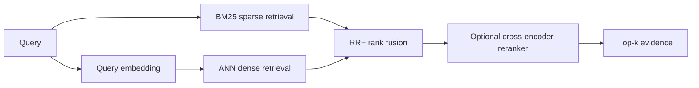
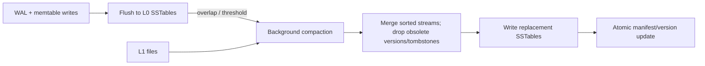
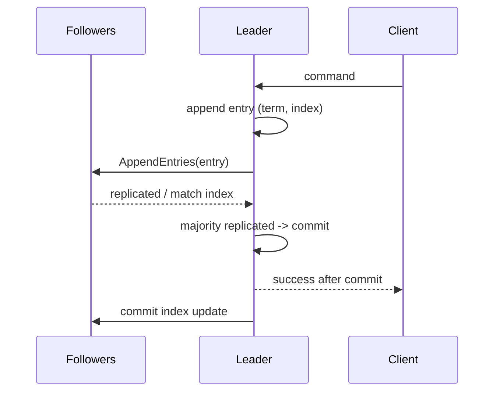

# Senior Software Engineer Algorithm & Backend Systems: Interview Q&A Masterclass

> A senior-level study guide for engineers with 5+ years of experience. The focus is on the structure behind the algorithms, where their guarantees stop, production trade-offs, and the failure modes interviewers expect experienced engineers to recognize.

## How to use this guide

For each question, lead with the invariant or trade-off, explain how the implementation works, then name the failure mode and the mitigation. Distinguish algorithmic guarantees from product-specific behavior: an Elasticsearch or database implementation may add caches, heuristics, and operational constraints beyond the abstract data structure.

## Contents

1. [Advanced searching, indexing, and search engines](#1-advanced-searching-indexing--search-engines)
2. [Storage engines and data structures](#2-storage-engines--data-structures)
3. [Distributed algorithms and coordination](#3-distributed-algorithms--coordination)
4. [Graph and routing algorithms at scale](#4-graph--routing-algorithms-at-scale)

---

## 1. Advanced Searching, Indexing & Search Engines

### 1.1 Inverted indexes, Lucene segments, and FSTs

#### The Interview Question

**How does Elasticsearch handle full-text search under the hood using inverted indexes and finite state transducers?**

#### The Ideal Senior Answer

Elasticsearch analyzes text into terms and indexes each term to the documents containing it. A query is analyzed similarly; Lucene looks up the query terms in the term dictionary, obtains their postings lists, combines those lists according to the query operator, and scores matching documents. Postings may contain document IDs, term frequency, and (when indexed) positions and offsets. These support Boolean matching, phrase queries, and relevance scoring.

Lucene writes immutable index segments. A refresh makes newly indexed data searchable by opening a new segment; background merges combine segments later. This design makes writes mostly append-oriented and allows concurrent search over stable segment files, but creates merge I/O and temporary space costs.

An FST is a compact automaton that maps term prefixes to outputs. Lucene uses an FST-based terms index to navigate the sorted term dictionary efficiently, including prefix/range navigation. Be precise: the FST is an index into term dictionary structures; it is not itself the postings list for every term. The inverted index is the term-to-document relation, and postings hold the document-level occurrence data.

#### Deep Dive / Under the Hood

For a field such as `"distributed lock safety"`, analysis may produce normalized terms such as `distributed`, `lock`, `safety`. Conceptually:

```text
Term dictionary / FST             Postings
---------------------             --------
distributed  --------->           doc 4, doc 19, doc 81 ...
lock         --------->           doc 4, doc 25, doc 81 ...
safety       --------->           doc 19, doc 81 ...
```

The FST shares common prefixes and stores transitions compactly. A sorted dictionary lets the engine seek to a prefix or term range without scanning every vocabulary entry. Postings are commonly encoded compactly (for example, delta-coded doc IDs), then decoded and intersected/merged during query execution. Segment immutability also makes many index structures memory-map friendly. Elasticsearch distributes an index over primary shards and replicas, so the coordinating node fans out a query and merges shard results; shard count and skew affect tail latency.

#### The “Gotcha” / Follow-up

**If the FST is compact, why can searching still be slow?** The FST only accelerates dictionary navigation. A query that expands to many terms, touches huge postings lists, requires phrase positions, scores many candidates, or fans out to many shards can still be expensive. The relevant counters are query time by shard, terms expanded, documents visited/matched, cache behavior, and merge pressure. Also ask what analyzer was used: tokenization, normalization, stemming, and synonyms define what “matching” means.

### 1.2 BM25 versus TF-IDF

#### The Interview Question

**BM25 vs. TF-IDF: why did modern search engines shift to BM25, and how does field-length normalization work?**

#### The Ideal Senior Answer

TF-IDF captures two intuitive signals: a term is useful when it appears often in a document but is uncommon across the corpus. Classical TF-IDF variants can let repeated occurrences increase score too aggressively and do not provide BM25’s calibrated saturation and length normalization.

BM25 is a probabilistic ranking function with diminishing returns for term frequency. For term (q_i) in document (D), one common form is:

\[
\mathrm{BM25}(D,Q)=\sum_i \mathrm{IDF}(q_i)\,
\frac{f(q_i,D)(k_1+1)}{f(q_i,D)+k_1(1-b+b\,|D|/\mathrm{avgdl})}
\]

Here (f(q_i,D)) is term frequency, (|D|) is the field length, `avgdl` is the corpus average field length, (k_1) controls term-frequency saturation, and (b\in[0,1]) controls length normalization. A longer field is normalized relative to average length. When (b=0), length does not affect the score; larger (b) applies stronger normalization. This is per field, so title and body can have different boosts and statistics.

#### Deep Dive / Under the Hood

The IDF component is typically larger for rare terms. Lucene’s BM25 implementation uses an IDF of the form \(\log(1 + (N-n+0.5)/(n+0.5))\), with (N) document count and (n) document frequency. The TF component saturates: the first few occurrences help substantially, while later repetitions add less. This models the empirical fact that seeing a word 20 times does not generally make a document 20 times more relevant than seeing it once.

Use BM25 as a strong lexical baseline, not as a universal answer. Analyze fields carefully, index exact identifiers separately, tune boosts against judged queries, and consider synonyms or domain-specific analyzers. Elasticsearch/Lucene expose (k_1) and (b) as tunable BM25 parameters; defaults are often a sensible starting point, not proof of optimality.

#### The “Gotcha” / Follow-up

**Why does a long document get penalized? Could that be wrong?** Normalization prevents long fields from winning merely because they contain more opportunities for a term match. But a long-form article can legitimately contain the best answer. Tune field boundaries and (b) against relevance judgments; avoid blindly applying one field’s length statistics to heterogeneous content. Also beware that shard-local statistics can make scores differ across shards, depending on the search settings and query.

### 1.3 Dense, sparse, and hybrid search; Reciprocal Rank Fusion

#### The Interview Question

**When do you use BM25 versus vector ANN search, and how does Reciprocal Rank Fusion work?**

#### The Ideal Senior Answer

Sparse lexical retrieval such as BM25 is strong for exact words, names, product codes, error messages, and rare tokens. Dense vector retrieval maps queries and passages into embedding space and can match paraphrases or conceptual similarity, but may miss exact identifiers and can return semantically related yet factually wrong passages. Approximate nearest-neighbor (ANN) indexes trade exactness for latency and memory efficiency.

Use hybrid retrieval when the workload contains both lexical and semantic intent. A common approach retrieves candidates independently from sparse and dense search, then combines rankings with RRF:

\[
\mathrm{RRF}(d)=\sum_{r\in\mathrm{rankers}}\frac{1}{k+\mathrm{rank}_r(d)}
\]

where (k) is a smoothing constant and a missing document contributes zero. RRF fuses ranks without requiring sparse and dense scores to share a scale. It is robust as a baseline but does not know business relevance; tune candidate depth, (k), and any reranking stage on judged queries.

#### Deep Dive / Under the Hood



ANN methods such as graph-based indexes (e.g. HNSW) explore a subset of the vector space. Their recall depends on index parameters and search effort. Dense and sparse candidate lists can be deduplicated by stable document/chunk IDs before fusion. Apply tenant/access filters during retrieval, not after unauthorized candidates have been exposed to an LLM. Evaluate Recall@k, MRR/nDCG, latency, memory, and answer quality.

#### The “Gotcha” / Follow-up

**Why not add the BM25 score directly to cosine similarity?** Their scales, distributions, and meanings differ, so an arbitrary weighted sum can let one dominate. Normalize or learn a fusion model if there is evidence it helps; RRF avoids score calibration by using ranks. Still, a reranker adds cost and latency, and cannot recover a relevant chunk absent from both candidate sets.

### 1.4 Fuzzy matching and cluster performance

#### The Interview Question

**Why can fuzzy matching in Elasticsearch destroy cluster performance, and how do you mitigate it?**

#### The Ideal Senior Answer

Fuzzy queries enumerate candidate terms within an edit distance using automaton-based term expansion, then execute those expanded terms. Cost grows with vocabulary size, edit distance, low prefix restriction, and expansion limits. Each shard has its own term dictionary, so fan-out multiplies work. Repeated broad fuzzy queries can consume CPU, create large rewritten queries, and hurt tail latency for unrelated traffic.

Mitigate with a small edit distance, nonzero `prefix_length`, bounded `max_expansions`, minimum query length, field scoping, rate limits, and a suggestion/autocomplete index designed for the use case. Prefer analyzer-time normalization, synonym handling, or a dedicated completion strategy when appropriate. Profile against realistic shard layouts and cap expensive-query access.

#### Deep Dive / Under the Hood

For edit distance 1, a term can vary by substitution, insertion, deletion, or (when enabled) adjacent transposition. The engine traverses the term dictionary/automaton to find accepted terms and rewrites them into a query. A prefix constraint fixes the first characters and prunes much of the search space. Elasticsearch exposes controls such as `fuzziness`, `prefix_length`, and `max_expansions`; its docs warn about high expansions, especially with no fixed prefix, and allow expensive queries to be disabled in supported deployments.

#### The “Gotcha” / Follow-up

**Would you set `max_expansions: 1` to make it safe?** It bounds terms per shard but degrades recall and still fans out across shards. Set a sensible cluster-level budget, query length policy, prefix requirement, and concurrency/rate limit; instrument expansion and latency. Also verify that the selected field is analyzed as expected: fuzziness is over indexed terms, not the raw string.

---

## 2. Storage Engines & Data Structures

### 2.1 B+ Trees versus LSM Trees

#### The Interview Question

**Compare B+ Trees in PostgreSQL/MySQL with LSM Trees in RocksDB/Cassandra for reads, writes, and space amplification.**

#### The Ideal Senior Answer

B+ Trees maintain sorted keys in pages with high fan-out. A point lookup follows a few page pointers, and nearby keys support efficient range scans. Inserts update a page in place logically; page splits, WAL, MVCC versions, and secondary indexes add write work. They are a natural fit for mixed read/write OLTP workloads and ordered access.

LSM Trees buffer writes in memory, flush sorted immutable files, and later compact them. This turns random writes into sequential writes and can offer high ingest throughput, especially on flash/storage where write patterns matter. Reads may consult memory plus multiple sorted files and filters; compaction reduces read/space amplification while creating write amplification and background I/O.

There is no categorical winner. Compare read amplification (work/files/pages consulted per logical read), write amplification (physical bytes written per logical byte), and space amplification (on-disk bytes relative to live data), plus range-scan behavior, durability, compaction budget, and workload skew.

#### Deep Dive / Under the Hood

```text
B+ Tree (sorted pages)              LSM Tree
        [root]                      writes -> WAL + memtable
       /      \                              |
   [leaf] <-> [leaf]                       flush
                                              v
                                      L0: overlapping SSTs
                                              |
                                         compaction
                                              v
                                      L1..Ln: sorted SSTs
```

In a B+ Tree, the internal pages guide search and leaf pages hold keys or tuple references. PostgreSQL indexes also interact with MVCC: obsolete tuple versions and index entries can affect maintenance and performance. In an LSM, newer values can shadow older values and tombstones. A point read may search memtables and multiple SSTables from newest to oldest; Bloom filters and block indexes avoid unnecessary disk reads.

Amplification depends on layout and compaction policy. Level compaction limits overlap among lower levels, improving point reads and space use but rewriting data repeatedly. Tiered/universal policies can reduce write amplification at the expense of more overlapping files, reads, or temporary space. RocksDB’s published tuning guidance quantifies these as policy-dependent trade-offs, not fixed constants.

#### The “Gotcha” / Follow-up

**Which is best for write-heavy workloads?** “LSM” is not a complete answer. If compaction cannot sustain ingest, pending compaction grows, disk space rises, and read/tail latency can collapse. If reads are latency-sensitive, an LSM may need more memory for filters/block cache and enough compaction bandwidth. Conversely, a B+ Tree workload can hit page split, random-write, WAL, or index-maintenance costs. Ask about key distribution, update rate, range scans, durability, and hardware.

### 2.2 Bloom Filters

#### The Interview Question

**How do Bloom filters work, and what are the trade-offs of false positives in distributed caching or storage compaction?**

#### The Ideal Senior Answer

A Bloom filter is a bit array with (m) bits and (k) hash probes. Inserting an item sets (k) bit positions. A membership query returns “definitely absent” if any probed bit is zero; if all are one, the item is “possibly present.” Standard Bloom filters have false positives but no false negatives, assuming no deletion or corruption and the filter matches the underlying set.

The approximate false-positive probability after inserting (n) items is:

\[
p\approx(1-e^{-kn/m})^k,\quad k_{opt}\approx(m/n)\ln 2
\]

In an LSM, a negative filter result can skip an SSTable lookup. A false positive merely causes an unnecessary read. In a cache, a false positive may cause a cache miss path to be skipped or a negative result to be trusted incorrectly depending on design; therefore define semantics carefully. Filters cost memory and CPU, and an undersized filter degrades toward always-positive.

#### Deep Dive / Under the Hood

```text
insert("key") -> h1,h2,...,hk -> set bits
query("key")  -> probe same k bits
                   any 0 -> definitely absent
                   all 1 -> possibly present
```

For a fixed false-positive target, more bits per key lower unnecessary lookups but consume RAM/disk. Hash count and load factor are coupled; too many probes increase CPU without improving the filter. Standard Bloom filters do not support deletion safely; counting Bloom filters can, at added space/counter complexity. In distributed use, stale membership state, inconsistent hashing, and replica lag are correctness questions beyond the Bloom filter’s probabilistic guarantee.

#### The “Gotcha” / Follow-up

**Can a Bloom filter be authoritative for “key does not exist”?** It can safely avoid a backing lookup only if the filter is complete and synchronized with that backing set. False positives cause extra work; false negatives can cause incorrect behavior and usually indicate a stale, corrupt, or incorrectly updated filter. Bloom filters also do not help ordinary range scans much because they answer point-membership questions.

### 2.3 Consistent hashing and virtual nodes

#### The Interview Question

**How does consistent hashing with virtual nodes reduce rebalancing and hot spotting in distributed key-value stores?**

#### The Ideal Senior Answer

Consistent hashing maps keys and node tokens into a circular hash space. A key is assigned to the next token clockwise. Adding or removing a token remaps only the adjacent key ranges rather than repartitioning all keys. Virtual nodes give each physical server multiple tokens, smoothing imbalance from a small number of partitions and allowing capacity-weighted ownership. When a physical node fails, its ranges can be redistributed across many remaining nodes.

Virtual nodes reduce partition-size variance; they do not eliminate hot keys or skewed access patterns. A single hot key still maps to one partition unless the application uses replication, caching, request coalescing, or key salting/partitioning. Capacity-aware weights and controlled rebalancing matter operationally.

#### Deep Dive / Under the Hood

```text
hash ring:  ... A1 ---- B1 ---- A2 ---- C1 ---- B2 ... (wraps)
key K hashes between A2 and C1 -> successor C1 owns the range
```

Each physical host owns multiple token intervals. More virtual nodes reduce the chance that one unlucky interval dominates a host, at the cost of more metadata, repair ranges, and potentially more movement events. Replication generally selects distinct physical hosts among successor tokens. During a rebalance, throttle streaming so data movement does not starve foreground reads/writes.

Be precise about product examples: Dynamo-style systems use ring/token concepts; **Redis Cluster uses 16,384 hash slots**, assigned to nodes, rather than a classic virtual-node ring. DynamoDB manages partitioning behind its service interface. The general partitioning lesson applies, but the exact mechanism differs.

#### The “Gotcha” / Follow-up

**Will adding 100 virtual nodes fix one tenant that sends 40% of traffic?** No. Virtual nodes smooth keyspace ownership, not request frequency. Mitigations include per-key/tenant quotas, caching, replication/read fan-out, adaptive partitioning, or splitting hot logical keys. Each changes consistency or write coordination. Detect skew from per-partition bytes, QPS, CPU, and latency, not only average load.

### 2.4 LSM compaction and tail latency

#### The Interview Question

**What happens during LSM compaction, and why can it cause tail-latency spikes?**

#### The Ideal Senior Answer

Compaction selects sorted files, reads their key ranges, merges entries in key order, resolves overwritten values and tombstones when safe, then writes new SSTables and updates metadata atomically. It reduces overlap and stale versions, improving reads and reclaiming space. But it competes with foreground traffic for disk bandwidth, CPU, cache, and I/O queue depth. It also creates write amplification and may temporarily need extra disk space. If compaction falls behind, L0 file count and read amplification rise; throttling or write stalls may eventually protect the database at the cost of write latency/availability.

#### Deep Dive / Under the Hood



Compaction scheduling competes with foreground reads and writes. A burst can saturate storage; compaction can also evict useful cache blocks. L0 files overlap, so point reads may check multiple candidates; compaction debt therefore harms reads even before visible write stalls. Monitor pending compaction bytes, L0 file count, bytes read/written by compaction, write stalls, disk queue depth, and p99/p999 latency. Mitigations include adequate I/O headroom, concurrency tuning, rate limiting ingest, workload isolation, and choosing a compaction style suited to latency/space goals. More compaction threads are not automatically better if the device is already saturated.

#### The “Gotcha” / Follow-up

**Why not pause compaction whenever p99 rises?** That treats a symptom and accumulates debt. Sustained pausing increases overlap, disk use, and eventual stall risk. Instead identify whether foreground I/O is saturated, right-size compaction bandwidth, apply backpressure early, and test the policy under realistic bursts and recovery. Tombstones also cannot be dropped until the engine can prove older shadowed values will not reappear from an uncompacted level or replica.

---

## 3. Distributed Algorithms & Coordination

### 3.1 Raft versus Paxos

#### The Interview Question

**Compare Raft and Paxos. Walk through leader election, log replication, and split-brain scenarios.**

#### The Ideal Senior Answer

Both are consensus families used to replicate state safely despite crash failures and message loss, assuming a majority quorum can communicate. Raft is organized around a leader and decomposes the problem into leader election, log replication, and safety. Paxos is often taught as proposer/acceptor/learner with ballot numbers and quorum intersection; Multi-Paxos commonly stabilizes a leader to make a sequence of decisions efficient. Avoid saying one is inherently more correct: implementations and operational protocol details matter.

In Raft, nodes track terms and vote at most once per term. A candidate requests votes and must obtain a majority; randomized election timeouts reduce repeated split votes. The elected leader appends client entries and replicates them with AppendEntries. Entries are committed when replicated to a majority, subject to Raft’s current-term commit rule. A disconnected old leader may still believe it is leader, but it cannot commit new entries without a majority. The majority side can elect a newer-term leader; the minority side cannot safely progress as a separate authoritative cluster.

#### Deep Dive / Under the Hood



Raft log matching ensures that if two logs contain the same index and term, their preceding entries match. Election restrictions prefer candidates with sufficiently up-to-date logs, preserving committed entries. In a 5-node cluster, a quorum is 3: a 3/2 partition allows only the 3-node side to commit. “Split brain” at the network level may produce two nodes claiming leadership transiently, but quorum intersection and terms prevent both sides from committing conflicting entries under the protocol assumptions. Real deployments must also handle membership changes, snapshots, disk durability, and client retry idempotency.

#### The “Gotcha” / Follow-up

**Does the leader reply as soon as one follower acknowledges?** No; a majority is required, and commit/apply semantics determine when a write is safe to acknowledge. **Can a client retry duplicate a command?** Yes. Consensus orders log entries; it does not automatically make application commands exactly-once. Use request IDs/deduplication in the replicated state machine. Also account for a leader crash after commit but before replying: the client cannot know from timeout alone whether the operation took effect.

### 3.2 Distributed locks, leases, Redlock, and fencing

#### The Interview Question

**How do distributed locks work? Compare Redis Redlock with consensus-backed coordination such as ZooKeeper or etcd. Why are time-based locks dangerous?**

#### The Ideal Senior Answer

A lock needs mutual exclusion, liveness/recovery after client failure, and a clear ownership/release protocol. A single Redis instance can use an atomic `SET key owner NX PX ttl` and compare-owner-and-delete release. Redlock attempts to acquire the same random ownership token on a majority of independent Redis masters within a validity interval, accounting for acquisition time and drift. This trades on timing assumptions and operational independence.

Consensus-backed coordinators such as etcd or ZooKeeper serialize coordination state through quorum and often expose leases, sessions, or ephemeral nodes. They provide stronger coordination semantics but introduce quorum availability and operational cost. Neither a TTL nor a successful lock response prevents a paused client from resuming after its lease expires and writing stale data. For correctness-critical writes, use **fencing tokens**: a monotonically increasing epoch attached to each lock grant, which the protected resource rejects if older than the latest accepted token. Prefer a transaction or compare-and-swap when it can directly enforce the invariant.

#### Deep Dive / Under the Hood

```text
Client A gets lease/token 41 -> pauses (GC, VM suspension, network)
lease expires; Client B gets token 42 -> writes resource
Client A resumes with token 41
resource rejects 41 because 42 was already accepted
```

Time-based safety depends on TTL, bounded clock-rate error, pause duration, and message timing. Wall-clock jumps can affect expiration systems; monotonic clocks avoid wall-clock adjustment but do not prevent process pauses or network delays. A fencing token moves the final safety check to the resource being protected. In an etcd/ZooKeeper-backed design, ensure the token/transaction revision is monotonic and passed through to that resource. The lock service alone cannot fence a database or external API that ignores the token.

Redis’s own Redlock guidance discusses validity windows, clock drift, and recommends considering fencing tokens for long-running work. There is published debate over Redlock’s assumptions; a senior answer should state the failure model and consequences, not present it as consensus-equivalent.

#### The “Gotcha” / Follow-up

**If the lease expires during a long GC pause, can the old owner still write?** It can attempt to. The lock service cannot retract code already running. Require a fencing token or a conditional write checked by the protected system, make operations idempotent, and keep critical sections bounded. Lock renewal improves liveness but adds another timing dependency; it does not eliminate stale-owner risk.

### 3.3 Clock drift and distributed leases

#### The Interview Question

**What is clock drift, and how can it break distributed leases?**

#### The Ideal Senior Answer

Clock offset is disagreement between clocks at a moment; clock drift is a difference in clock rates over time. A lease protocol that assumes expiry at a real-time deadline can fail if participants’ clocks progress at different rates or a process pauses. One node may believe a lease remains valid while another has expired it and granted a new lease. Network delay adds uncertainty about when grants or renewals took effect.

Use monotonic clocks for local elapsed-time measurement, conservative safety margins, bounded lease durations, and renewal protocols designed for the stated drift model. For resource correctness, fencing tokens or conditional writes are stronger than hoping clocks remain close. NTP synchronization improves operations but does not create a correctness proof.

#### Deep Dive / Under the Hood

Suppose A receives a lease valid for (T), then pauses for (T+\epsilon). B may have acquired a new lease and updated the resource before A resumes. Even if A’s local wall clock did not jump, its process had no chance to renew while paused. A faster clock can also expire a lease earlier than peers expect; a slower clock can make an old owner believe it is valid too long. Therefore distributed lease safety requires a bound on clock-rate error and operation completion within the conservative validity window, or a resource-side fencing mechanism.

#### The “Gotcha” / Follow-up

**Does NTP solve lease safety?** No. It reduces clock offset in normal operation but does not prevent process suspension, network partition, VM pauses, or a client acting on a stale lease. NTP is operational hygiene; fencing/conditional writes enforce resource ordering.

### 3.4 Rate limiting algorithms

#### The Interview Question

**Compare token bucket, leaky bucket, and sliding-window counter. Which would you use for a multi-tenant API gateway?**

#### The Ideal Senior Answer

Token bucket accumulates up to a burst capacity (B) at refill rate (r). A request of cost (c) is allowed if the bucket has at least (c) tokens. It permits bounded bursts while enforcing a long-run average rate. Leaky bucket drains work at a fixed rate, smoothing output; depending on implementation it may queue or reject overflow. A sliding-window log is exact but stores request timestamps. A sliding-window counter approximates recent usage with current/previous fixed-window counts and is cheaper, but can misestimate near boundaries.

For a multi-tenant gateway I would usually start with a token bucket per tenant/API key, with hierarchical limits for global, tenant, and endpoint capacity. Use an atomic shared store or gateway-local tokens with carefully bounded skew, define fail-open/closed behavior, and return `429` with retry guidance. Weighted request costs can account for expensive endpoints. The choice depends on whether the product wants burst tolerance or smooth service and how much distributed coordination overhead it can accept.

#### Deep Dive / Under the Hood

```python
def allow(bucket, now, cost=1):
    # Execute as one atomic Redis script/transaction, not separate client writes.
    elapsed = max(0, now - bucket.updated_at)
    tokens = min(bucket.capacity, bucket.tokens + elapsed * bucket.refill_rate)
    if tokens < cost:
        retry_after = (cost - tokens) / bucket.refill_rate
        return False, retry_after
    bucket.tokens = tokens - cost
    bucket.updated_at = now
    return True, 0
```

The code shows the state transition, not a safe distributed implementation: timestamp and token updates must be atomic, server-side time should be consistent within the limiter’s failure model, and keys need TTL/eviction policy. If every API node maintains independent counters, a tenant can multiply its allowance by the number of nodes. A centralized Redis limiter is more consistent but adds a network dependency and hot-key pressure; local token leases can reduce calls at the cost of bounded over-admission.

#### The “Gotcha” / Follow-up

**What happens if Redis is down?** Decide based on endpoint risk: fail closed for costly or abuse-sensitive actions, or fail open with conservative local emergency limits for availability. Document the bound. Also consider tenant creation/deletion, clock source, policy updates, burst capacity, weighted costs, and whether limits apply globally across regions. A limiter that serializes every request can become the bottleneck it was meant to protect.

---

## 4. Graph & Routing Algorithms at Scale

### 4.1 Dijkstra versus A*

#### The Interview Question

**Compare Dijkstra and A*. When does A* fail if its heuristic is not admissible?**

#### The Ideal Senior Answer

Dijkstra’s algorithm finds shortest paths from a source with nonnegative edge weights, expanding the lowest known-distance vertex. A* orders the frontier by \(f(n)=g(n)+h(n)\), where (g) is exact cost from the source and (h) estimates remaining cost to the goal. With (h=0), A* is Dijkstra. An admissible heuristic never overestimates the true remaining cost; with the usual graph-search conditions (and correct reopening behavior where needed), this preserves optimality while often expanding fewer nodes.

If the heuristic overestimates, A* may pop a goal whose (g)-cost is not globally minimal and return a suboptimal path. A consistent heuristic satisfies (h(u)\le c(u,v)+h(v)), making (f) nondecreasing along paths and avoiding reopenings in common closed-set implementations. For geographic routing, straight-line distance divided by a maximum possible speed can be an admissible travel-time heuristic if edge costs obey that bound.

#### Deep Dive / Under the Hood

```text
priority = g(node) + h(node)
relax edge u -> v with cost c:
    candidate = g[u] + c
    if candidate < g[v]:
        g[v] = candidate
        parent[v] = u
        push(v, candidate + h(v))
```

For a binary heap implementation, Dijkstra/A* are typically (O((V+E)\log V)) in sparse graphs, with exact complexity depending on queue and graph representation. Early termination at target is valid when the target is removed from the priority queue under the algorithm’s correctness conditions—not merely when it is first discovered. If a heuristic is inconsistent, a node may need reopening after a better path is found.

#### The “Gotcha” / Follow-up

**Can you use Euclidean distance as the heuristic for driving time?** Not directly unless converted into a lower bound on travel time (e.g. divide by a valid upper bound on speed) and road/path costs cannot be lower. Straight-line distance itself is a distance lower bound for distance metrics; it is not automatically a time lower bound. If the heuristic is inadmissible, optimality can be sacrificed for speed, but that must be explicit.

### 4.2 Topological sorting and dependency resolution

#### The Interview Question

**How is topological sorting used in CI/CD pipeline dependency resolution or package managers?**

#### The Ideal Senior Answer

A topological ordering linearizes a directed acyclic graph (DAG) so every dependency precedes its dependent. CI systems use it to schedule build/test/deploy jobs once prerequisites complete; package managers use it to order installation or build steps after resolving dependency constraints. Kahn’s algorithm repeatedly removes zero-indegree vertices; DFS can also produce an order by reverse postorder. Both run in (O(V+E)).

If the graph contains a cycle, no topological ordering exists. The system should report an actionable cycle path rather than hang or silently omit a task. For parallel execution, execute all currently ready nodes subject to resource limits; a topological order alone is not a scheduler and does not account for CPU, exclusivity, retries, or critical path.

#### Deep Dive / Under the Hood

```text
Kahn(G):
  indegree[v] = number of prerequisites of v
  ready = all v with indegree[v] == 0
  order = []
  while ready not empty:
      v = pop(ready)
      append v to order
      for each dependent w of v:
          indegree[w] -= 1
          if indegree[w] == 0: push(ready, w)
  if len(order) != |V|: report cycle among remaining vertices
```

For CI/CD, annotate each node with resource requirements, cache keys, retry policy, and whether a failure blocks downstream jobs. Package dependency resolution may first need version constraint solving; topological sorting applies after selecting a compatible dependency graph. Build reproducibility also requires pinning versions and hashing inputs, not just getting a valid order.

#### The “Gotcha” / Follow-up

**Can two ready jobs run concurrently just because they have no path between them?** Algorithmically yes, but operational constraints may forbid it: shared mutable environments, deployment locks, rate limits, limited runners, or order-sensitive side effects. A scheduler must combine DAG readiness with resource admission and cancellation semantics.

### 4.3 Contraction Hierarchies and dynamic road routing

#### The Interview Question

**How do routing engines optimize shortest-path queries on massive road graphs using Contraction Hierarchies? How do dynamic traffic weights affect the design?**

#### The Ideal Senior Answer

Contraction Hierarchies (CH) exploit the hierarchy of road networks. In preprocessing, assign an importance order to vertices and contract low-importance vertices one by one. When removing a vertex (v), add shortcut edges between its neighbors whenever they are needed to preserve shortest-path distances through (v). A query then performs a bidirectional upward search—each direction follows edges toward more important vertices—and combines at a meeting point. It searches far fewer vertices than ordinary Dijkstra on many road networks.

The trade-off is preprocessing time, shortcut count/space, and sensitivity to weight changes. If travel-time weights change frequently, a fully preprocessed CH may become stale. Options include customizable CH (precompute topology/order, then customize weights more cheaply), partial/limited customization, a dynamic overlay for local incidents, or fallback search for affected regions. Real routing also considers turn restrictions, edge-based state, traffic prediction, closures, and multiobjective constraints—not merely a static node-weighted graph.

#### Deep Dive / Under the Hood


When contracting (v), a witness search checks whether a path from neighbor (u) to neighbor (w) with cost no greater than \(c(u,v)+c(v,w)\) exists without using (v). If no witness path exists, preserve the shortest path with a shortcut (u\to w). Query search explores upward edges in each direction; the shortest route is represented through a meeting node and possibly nested shortcuts, which are unpacked for turn-by-turn output.

Dynamic weights complicate witness decisions and shortcut weights. Customizable CH separates topology-dependent preprocessing from metric customization so new edge weights can be incorporated faster than a full rebuild, though query speed/optimality depends on the variant and update model. Traffic changes can also be forecast rather than instantaneous; operationally, route quality and update freshness must be measured together.

#### The “Gotcha” / Follow-up

**Does CH make every query sublinear or guarantee a fixed number of visited nodes?** No universal bound like that follows for arbitrary graphs and orders. The impressive speedups rely on road-network structure and good contraction orders. Poor orders create many shortcuts; dynamic metric changes may require customization or degrade the query structure. Measure preprocessing time, shortcut growth, query node count, p99 latency, and update freshness on representative regions.

---

## Senior Interview Checklist

- State the guarantee and its assumptions before discussing optimizations.
- Separate data-structure cost from contention, I/O, network, and scheduler cost.
- Discuss p99/p999 behavior, not only average throughput.
- Name what can become stale: index statistics, filters, caches, replicas, leases, weights, or model artifacts.
- Explain backpressure, bounded concurrency, retry/idempotency, and observability.
- For a proposed mitigation, state its new cost or consistency trade-off.
- Use product examples accurately: Elasticsearch/Lucene, Redis Cluster, Dynamo-style rings, and DynamoDB do not have identical internals.

## References

- [Lucene `BM25Similarity` API](https://lucene.apache.org/core/10_5_2/core/org/apache/lucene/search/similarities/BM25Similarity.html)
- [Elasticsearch fuzzy query reference](https://www.elastic.co/guide/en/elasticsearch/reference/current/query-dsl-fuzzy-query.html)
- [Elasticsearch expensive query controls](https://www.elastic.co/guide/en/elasticsearch/reference/current/query-filter-context.html)
- [RocksDB tuning guide](https://github.com/facebook/rocksdb/wiki/RocksDB-Tuning-Guide)
- [RocksDB Bloom Filter documentation](https://github.com/facebook/rocksdb/wiki/RocksDB-Bloom-Filter)
- [Dynamo: Amazon’s Highly Available Key-value Store](https://www.amazon.science/publications/dynamo-amazons-highly-available-key-value-store)
- [Raft paper](https://raft.github.io/raft.pdf)
- [Redis distributed locks and Redlock](https://redis.io/docs/latest/develop/clients/patterns/distributed-locks/)
- [Contraction Hierarchies: Faster and Simpler Hierarchical Routing in Road Networks](https://ai.dmi.unibas.ch/research/reading_group/geisberger-et-al-wea2008.pdf)
- [PostgreSQL B-Tree implementation notes](https://www.postgresql.org/docs/current/btree.html)

